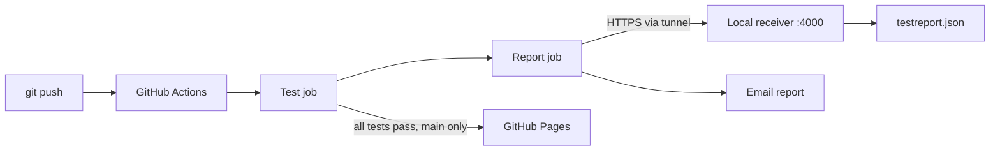

# Assignment Submission Portal


A tested assignment submission portal built for **DevOps for Cloud Computing (CSC418)** at COMSATS University Islamabad, Attock Campus. Students submit their name, registration number, assignment title and a link to their work. Every push is tested automatically, and the full test report is delivered to a local receiver as `testreport.json` and emailed to the instructor.

**Live demo:** https://shahhumayun.github.io/assignment-submission-portal/
*(Runs in demo mode: submissions are stored in the visitor's browser, because GitHub Pages cannot host the Express backend.)*

## Architecture



## Features

- Submission form with client-side and server-side validation
- Searchable submission list, newest first
- Express REST API
- Automated tests (Vitest + Supertest)
- CI on every push, with a JSON test report delivered to a local receiver
- Report emailed after both passing and failing runs
- Static demo deployed to GitHub Pages only when all tests pass

## Tech stack

| Layer | Technology |
|---|---|
| Frontend | Vue 3, Vite, Vue Router |
| Backend | Node.js, Express |
| Tests | Vitest, Supertest |
| CI/CD | GitHub Actions, GitHub Pages |
| Report delivery | Node HTTP receiver, Cloudflare quick tunnel |

## Project structure

```
Assignment-Portal/
├── client/            Vue frontend
├── server/            Express API
│   ├── src/           app, store, validation
│   └── tests/         automated tests
├── receiver/          local HTTP receiver for test reports
├── scripts/           report builder and job summary
├── evidence/          screenshots and reports from the demo runs
└── .github/workflows/ CI pipeline
```

## Prerequisites

- Node.js 20 or newer
- Git
- `cloudflared` (only to receive CI reports on your own machine)

## Run the application

Use two terminals.

**API (http://localhost:3000)**

```bash
cd server
npm install
npm run dev
```

**Frontend (http://localhost:5173)**

```bash
cd client
npm install
npm run dev
```

Submissions are saved to `server/data/submissions.json`.

## Run the tests

```bash
cd server
npm install
npm test
```

| Test case | Expected result |
|---|---|
| Complete details and a valid submission URL | Saved and listed |
| Missing registration number | Rejected with a validation message |
| Invalid submission URL | Rejected and not saved |

A failing test exits with a non-zero code, which fails the CI test stage. Each run also writes `server/test-results.json`, which the report is built from.

## API

| Method | Endpoint | Description |
|---|---|---|
| GET | `/api/health` | Health check |
| GET | `/api/submissions` | List submissions |
| POST | `/api/submissions` | Create a submission |

```json
{
  "name": "Student Name",
  "registrationNumber": "FA22-BCS-000",
  "assignmentTitle": "Lab 3",
  "submissionUrl": "https://github.com/user/repo"
}
```

Responses: `201` with the saved record, or `400` with `{ "message": "Validation failed", "errors": { ... } }`.

## CI/CD pipeline

`.github/workflows/ci.yml` runs on every push:

| Job | What it does |
|---|---|
| **Test** | Installs dependencies, runs the tests, writes a results summary, uploads `test-results.json`. A failed test fails this job. |
| **Send report to localhost** | Always runs. Builds the report from the real results and POSTs it to the local receiver. |
| **Build demo site** | `main` only, and only if Test passed. |
| **Deploy to GitHub Pages** | Publishes the build. A failing run never reaches this job, so the previous site stays unchanged. |

## Test report

The report is built by `scripts/build-report.mjs` from the actual test run and contains:

- repository, branch, commit SHA, pipeline run identifier and run URL, execution timestamp
- every test's name, result, and failure message where applicable
- total, passed and failed counts, and the overall status (`passed` or `failed`)

## Receive the report locally

GitHub-hosted runners cannot reach your computer's `localhost`, so the receiver is exposed through a tunnel. Keep **both windows open** while the pipeline runs.

**1. Start the receiver** with a shared secret token (PowerShell):

```powershell
cd receiver
$env:REPORT_TOKEN = (node -e "console.log(require('crypto').randomBytes(24).toString('hex'))")
$env:REPORT_TOKEN | Set-Clipboard
npm start
```

**2. Start a tunnel** in a second terminal:

```powershell
cloudflared tunnel --url http://localhost:4000
```

It prints an address like `https://<random-words>.trycloudflare.com`. The address changes every time the tunnel restarts.

**3. Set the repository secrets** (Settings → Secrets and variables → Actions):

| Secret | Value |
|---|---|
| `REPORT_URL` | the tunnel address (no trailing slash, no `/report`) |
| `REPORT_TOKEN` | the token generated above |

The receiver validates each report, rejects requests without the correct token, and saves the latest report as `receiver/testreport.json` (plus a timestamped copy in `receiver/reports/`).

## Email report

After every run, passing or failing, the pipeline emails the report (commit, overall result, counts and individual results). Configuration lives in repository secrets, never in the code:

| Secret | Purpose |
|---|---|
| `<EMAIL_SECRET_1>` | `<e.g. sender address>` |
| `<EMAIL_SECRET_2>` | `<e.g. app password>` |
| `<EMAIL_SECRET_3>` | `<e.g. recipient address>` |

## GitHub Pages

Enable **Settings → Pages → Source: GitHub Actions**. The demo is built with `VITE_DEMO_MODE=true`, so it runs without a backend and stores submissions in the browser.

## Demo evidence: pass, fail, fix

The `evidence/` folder contains screenshots and the received JSON reports for three consecutive runs:

1. **Passing run:** all 13 tests pass; report received and saved; site deployed.
2. **Failing run:** a defect (registration check removed) fails 3 tests; Test stage red; report still delivered with `"overallStatus": "failed"`; Pages deployment skipped, so the live site is unchanged.
3. **Fixed run:** the defect is reverted; all tests pass again; report received; site deployed.

## Author

Shah Humayun, BSCS, COMSATS University Islamabad, Attock Campus